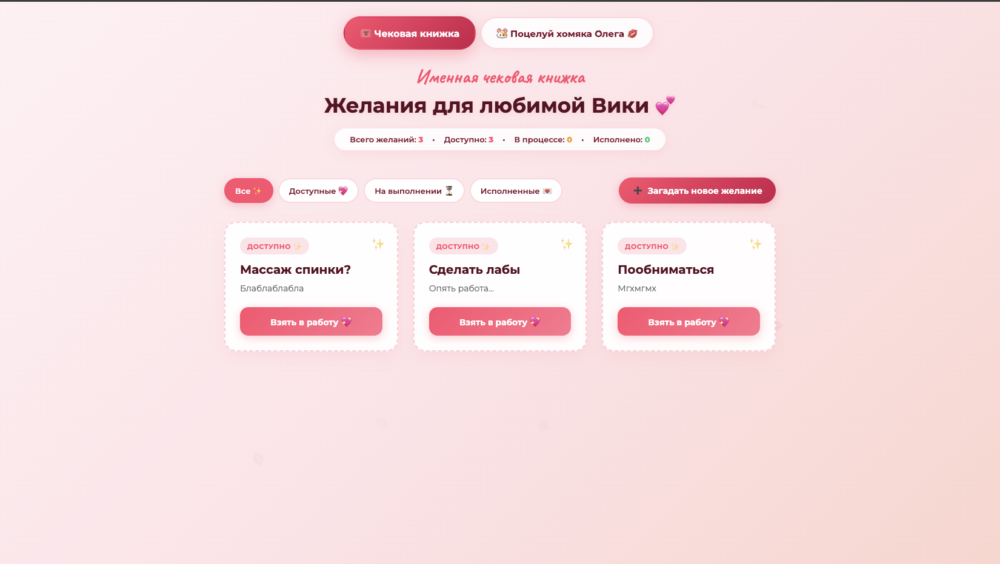

<div align="center">

# 🎟️ For Vika Love 💕
### Интерактивная «Чековая книжка желаний» & Тапалка «Поцелуй хомяка Олега 🐹💋»

[](https://www.oracle.com/java/)
[](https://spring.io/projects/spring-boot)
[](https://www.postgresql.org/)
[](https://www.docker.com/)
[](https://render.com/)
[](#)

<br/>

<!-- СКРИНШОТ ПРОЕКТА -->
<p align="center">
  
</p>

<p align="center">
  <b>Романтический Fullstack Pet-проект</b>, созданный специально для любимой девушки.<br>
  Позволяет загадывать и отслеживать исполнение желаний, а также заботиться о домашнем питомце — Хомяке Олеге.
</p>

[✨ Возможности](#-ключевой-функционал) •
[🐹 Эволюция Хомяка](#-эволюция-хомяка-олега) •
[🛠 Стек технологий](#-стек-технологий) •
[📡 REST API](#-api-эндпоинты) •
[🚀 Запуск](#-быстрый-запуск-локально) •
[🐳 Docker & Deploy](#-деплой-на-rendercom)

---

</div>

## 🌟 Ключевой функционал

### 1. 🎟️ Чековая книжка желаний
* **Жизненный цикл купонов:**
  * `AVAILABLE` (Доступно) ➔ `IN_PROGRESS` (Олег выполняет...) ➔ `COMPLETED` (Исполнено с фиксацией даты).
* **Категории желаний:** 💖 *Романтика*, 💆‍♀️ *Забота*, 🎉 *Веселье*, 🍕 *Вкусняшки*, 📚 *Учеба*.
* **Интерактивные фильтры & статистика:** Живой подсчет статусов купонов в реальном времени.
* **🚨 Пасхалка «Проверка чувств»:** 
  * Срабатывает на каждый 3-й купон с вопросом: *«Ты меня ненавидишь? 🥺»*.
  * Кнопка *«Да»* убегает от курсора и пальца по экрану, не оставляя шанса ответить неверно.
  * Адаптирована под смартфоны с отдельной безопасной зоной клика.

### 2. 🐹 Интерактивная тапалка «Поцелуй хомяка Олега»
* **Динамическая SVG-эволюция:** Внешний вид хомяка меняется в зависимости от количества поцелуев.
* **Optimistic UI & Batching:** Экран моментально откликается на клики, а запросы пачками отправляются на бэкенд, исключая лишнюю нагрузку на сервер.
* **Тактильный отклик (Haptic Feedback):** Микровибрация при тапах на мобильных устройствах.
* **Ленивый суточный сброс (Lazy Daily Reset):** 
  * Если поцелуев не было сегодня (`isBefore(LocalDate.now())`), хомяк автоматически обнуляется при первом же визите.
* **Праздничные эффекты:** Выстрелы конфетти при переходе на каждый новый уровень любви.

---

## 🐹 Эволюция Хомяка Олега

Хомяк проходит путь от брошенного бедолаги до абсолютного короля жизни:

| Уровень | Поцелуи | Статус хомяка | Внешний вид & Настроение |
| :---: | :---: | :--- | :--- |
| **I** | `0 .. 49` | *«Грустный Одинокий Нелюбимый... Хомяк»* | 🥺 Бледный, взъерошенный, в пятнах грязи и с пластырем. |
| **II** | `50 .. 199` | *«Довольный хомяк Олег»* | 🍪 Чистый, блестящий, хрустит печенькой с шоколадом. |
| **III** | `200 .. 499` | *«Любими Олег»* | 😍 Глазки-сердечки, яркий румянец, обнимает сердечко. |
| **IV** | `500 .. 999` | *«Зацелованный Олег»* | 💋 С ног до головы покрыт поцелуями с помадой, пьян от счастья. |
| **V** | `1000+` | *«Абсолютно довольный хомячок»* | 👑🕶️🍹 Возлежит на шезлонге в черных VIP-очках с коктейлем. |

---

## 🛠 Стек технологий

* **Backend:**
  * **Java 17** (LTS)
  * **Spring Boot 3** (Spring Web, Spring Data JPA)
  * **Hibernate ORM** (Автоматическая генерация схем, аудит дат)
  * **PostgreSQL** (Реляционная база данных)
  * **Global Exception Handling** (`@RestControllerAdvice`)
* **Frontend:**
  * **Vanilla JavaScript** (ES6+, Fetch API, Touch Events, Vibration API)
  * **HTML5 & CSS3** (Mobile-first, Flexbox/Grid, Glassmorphism, CSS Animations)
  * **Inline SVG Art** (Векторная графика без тяжелых растровых картинок)
  * **Canvas Confetti** (Праздничная анимация частиц)
* **DevOps & Инфраструктура:**
  * **Docker** (Multi-stage сборка: Maven Build ➔ Eclipse Temurin JRE)
  * **Render.com** (PaaS-хостинг бэкенда и БД PostgreSQL)

---

## 📡 API Эндпоинты

### 🎟️ Купоны (`/api/coupons`)
| Метод | Эндпоинт | Описание |
| :--- | :--- | :--- |
| `GET` | `/api/coupons` | Получить все купоны желаний |
| `POST` | `/api/coupons` | Создать новое желание `{ title, description, category }` |
| `POST` | `/api/coupons/{id}/take` | Взять купон в работу (статус `IN_PROGRESS`) |
| `POST` | `/api/coupons/{id}/complete` | Отметить желание исполненным (статус `COMPLETED`) |

### 🐹 Хомяк-кликер (`/api/hamster`)
| Метод | Эндпоинт | Описание |
| :--- | :--- | :--- |
| `GET` | `/api/hamster` | Получить состояние хомяка (с автопроверкой даты) |
| `POST` | `/api/hamster/kiss?count=N` | Подарить `N` поцелуев хомяку и обновить ранг |

---

## 🚀 Быстрый запуск локально

### 1. Требования
* Установленный **JDK 17+**
* Запущенный **PostgreSQL** (порт 5432)
* Установленный **Maven** (или `mvnw`)

### 2. Клонирование репозитория
```bash
git clone https://github.com/pyfas78/forVikaLove.git
cd forVikaLove
```

### 3. Настройка базы данных
В файле `src/main/resources/application.properties` укажи свои данные:
```properties
spring.datasource.url=jdbc:postgresql://localhost:5432/forVikaLove_db
spring.datasource.username=postgres
spring.datasource.password=your_password
spring.jpa.hibernate.ddl-auto=update
```

### 4. Запуск
```bash
./mvnw spring-boot:run
```
После запуска открой в браузере: **`http://localhost:8080`** 💖

---

## 🐳 Деплой на Render.com

Проект полностью укомплектован для деплоя через Docker:

1. **Создай PostgreSQL Database** на [Render.com](https://render.com).
2. **Создай новый Web Service**, подключив этот GitHub-репозиторий.
3. Выбери среду сборки **Docker**.
4. В разделе **Environment Variables** укажи:
   * `SPRING_DATASOURCE_URL` = Внутренний JDBC URL базы с Render (например, `jdbc:postgresql://...`)
   * `SPRING_DATASOURCE_USERNAME` = имя пользователя базы данных
   * `SPRING_DATASOURCE_PASSWORD` = пароль базы данных
   * `SPRING_JPA_HIBERNATE_DDL_AUTO` = `update`
5. Нажми **Deploy** — сервис соберётся в легковесном multi-stage контейнере и станет доступен по публичной ссылке!

---

<div align="center">

Разработано с огромной любовью для **Вики** 💕<br>
<sub>© 2026 Oleg Danilovich. Все права на поцелуи хомяка защищены.</sub>

</div>
